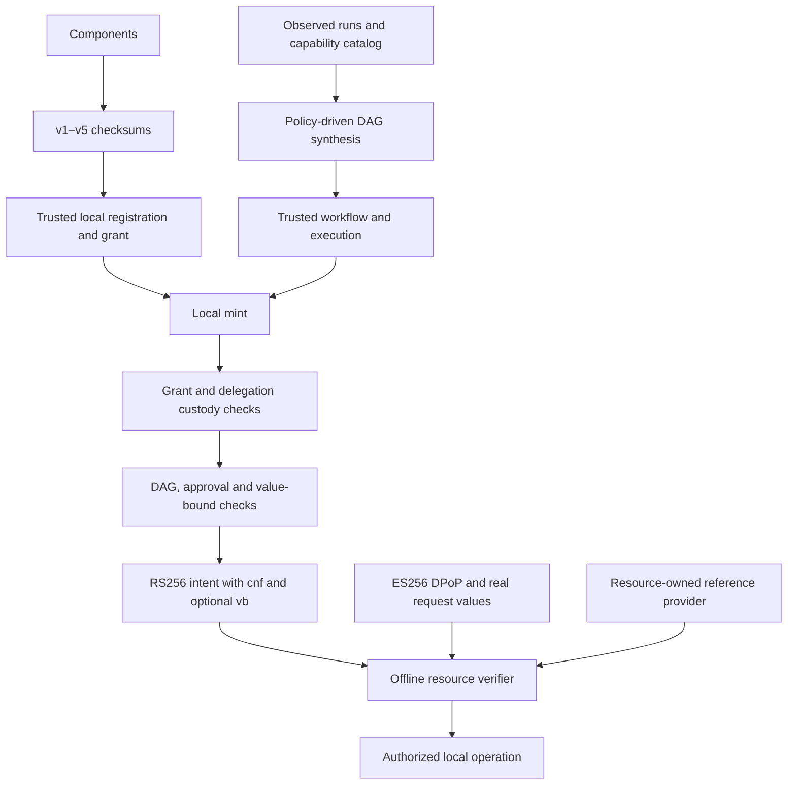

# Local Auth51 algorithm alignment

The `agentic_jwt::auth51` module implements local identity, authorization and
governance algorithms. The product runtime is Rust throughout: no Auth51 API
client, Python interpreter, subprocess or source execution is required.

| Rust module | Reference behavior |
|---|---|
| `identity.rs` | v1–v5 component checksums, Python JSON representation, NFC, process-tool filtering and source identity |
| `source.rs` | Native Python AST parsing, docstring removal and canonical source rendering |
| `algorithms.rs` | Route scopes, constrained action hashes, holder thumbprints and trace hashes |
| `types.rs` | Grant envelopes, executions, DAG steps, intent and value-binding types |
| `engine.rs` | Registered checksums, grants, step-up scopes, custody, delegation, execution-selected governance and intent claims |
| `workflow.rs` | Strict/guarded DAG matching, dependencies, approvals, candidate resolution and workflow fingerprints |
| `policy.rs` | Tier classification, evidence-dependent guards and registration guard floors |
| `synthesis.rs` | Observed-run support, always-before ordering, capability guards and static amount bounds |
| `effects.rs` | Native static source analysis and consequence aggregation with the unknown floor |
| `valuebind.rs` | Static operand freezing, closed predicates, action hashes and resource reference checks |
| `extraction.rs` | Body/query/path extraction and resource-owned provider argument resolution |
| `crypto.rs` | Offline RS256 issuer/JWKS verification, ES256 DPoP, access-token binding and legacy RSA PoP |

`AgentSpec::checksum()` selects v3 without tools and v4 with process tools.
`Components` exposes all five profiles; `checksum_v5()` uses the native Rust
normalizer. `checksum_legacy_jcs()` remains an explicit migration helper.
Registrations made with the previous checksum profile need re-registration.

The shared file MCP authorization function now uses `LocalAuthority`: a local
grant, execution-selected DAG, independently completed human approval, a
proposal-hash value bound, RS256 intent and ES256 DPoP. Its signed full-proposal
receipt and durable SQLite reservation remain additional executor safeguards.
The older root `Authority` API is retained for existing experimental consumers;
it still implements the original Ed25519/linear-workflow model. Consumers seeking
Auth51 behavior should use `auth51::LocalAuthority` and `ResourceVerifier`.

Compatibility deliberately includes current reference details: caller-supplied
workflow opt-out flags do not disable governance; execution mode overrides the
stored workflow mode; custody checks remain hard failures in observe mode;
approval lookup follows alphabetical step ordering; workflow fingerprints omit
tier/value-bound metadata; DPoP binds the full URL including its query. The
reference verifier currently has no proof replay cache; Rust's verifier defaults
to that behavior and provides an explicit `reject_replay` safeguard used by MCP.

The policy and recognizer JSON files are snapshots of the local Auth51 defaults.
Hosts may supply their own `TierPolicy`. Reference providers and trusted policy
mutators are host-side operations, not agent-controlled tool inputs.

`tests/fixtures/auth51.json` and `auth51-policy.json` contain independent outputs
from the local checksum/scopes libraries and actual authority/governance
functions. The Python scripts under `tools/` only regenerate development
fixtures. Tests do not launch Python. They cover identity profiles, grants,
delegation custody, DAG matching, tier guards, value predicates, native source
normalization, analysis, synthesis and consequence resolution. Native tests also
exercise offline JWT/DPoP rejection and a real signed workspace apply with
tampering/replay rejection. Linux-only hardened-service tests are not exercised
by a Windows test run.

The native unparser fork under `vendor/rustpython-unparser` retains its MIT
license and records its CPython compatibility fixes. Python AST rendering can
vary by Python version; the fixture corpus demonstrates agreement for tested
syntax and is not a proof for every possible Python program. Custom Python-only
regex extensions, custom extractor plugins and dynamically registered Python
value functions are not automatically translated into Rust. HTTP endpoints,
database/service lifecycle, discovery and remote configuration are outside this
local-library alignment.

Validation: `cargo test --locked --all-targets`,
`cargo clippy --locked --all-targets -- -D warnings`, and `cargo fmt --check`.
